

<h1>Sieci neuronowe</h1>

<h2>Klasyfikacja i regresja z użyciem perceptronu wielowarstwowego</h2>

<strong>Autorzy</strong> 
Maksymilian Majewski 
Łukasz Przybylski

<strong>Prowadzący</strong> 
mgr inż. Mikołaj Małkiński

Wydział Matematyki i Nauk Informacyjnych 
Politechnika Warszawska

26 października 2026

---

# Wstęp
Praca dotyczy perceptronu wielowarstwowego (MLP) uczonego algorytmem propagacji wstecznej błędu. Zaimplementowano własną sieć i wykorzystano ją do rozwiązania dwóch rodzajów zadań na zbiorach udostępnionych w ramach zajęć: klasyfikacji wektorów z $\mathbb R^2$ oraz regresji funkcji $\mathbb R\to\mathbb R$. Celem było sprawdzenie, jak na jakość uczenia wpływają funkcja aktywacji, liczba warstw ukrytych i neuronów w nich, miara błędu, obecność biasu, rozmiar zbioru uczącego i parametry samego uczenia.

---

# 1. Wstęp teoretyczny

## 1.1 Pojedynczy neuron
Podstawowym elementem sieci jest sztuczny neuron. Przyjmuje on kilka liczb wejściowych $x_1,\dots,x_n$, mnoży każdą przez własną wagę $w_j$, sumuje wyniki, dodaje przesunięcie (bias) $b$ i przepuszcza całość przez funkcję aktywacji $f$:

$$z=\sum_{j=1}^{n}w_jx_j+b,\qquad a=f(z).$$

Wagi i bias są parametrami, których sieć uczy się z danych.

## 1.2 Perceptron i jego ograniczenie
Perceptron to najprostsza sieć, czyli neurony bez warstw ukrytych, z aktywacją skokową ($a=1$ dla $z\ge0$, w przeciwnym razie $a=0$). Równanie $\sum_j w_jx_j+b=0$ opisuje prostą (w 2D) lub hiperpłaszczyznę dzielącą przestrzeń na dwie części. Perceptron potrafi więc rozdzielić dwie klasy tylko wtedy, gdy można je oddzielić jedną prostą (problem liniowo separowalny). Gdy się nie da, zawodzi - klasycznym przykładem jest XOR: punkty $(0,1)$ i $(1,0)$ należą do klasy 1, a $(0,0)$ i $(1,1)$ do klasy 0, i żadna prosta ich nie rozdzieli.

## 1.3 Warstwy ukryte
Rozwiązaniem jest dodanie warstw ukrytych. Każdy neuron ukryty wyznacza jedną prostą, a neuron wyjściowy łączy kilka takich prostych w nieliniową granicę decyzyjną. Taka sieć to perceptron wielowarstwowy (MLP). Dla warstw $l=1,\dots,L$ (wejście, $l=0$, tylko przekazuje dane i nie jest liczone) obliczamy kolejno:

$$a^{[0]}=x,\qquad z^{[l]}=W^{[l]}a^{[l-1]}+b^{[l]},\qquad a^{[l]}=f^{[l]}\!\left(z^{[l]}\right),\qquad \hat y=a^{[L]}.$$

## 1.4 Funkcje aktywacji
Aktywacje warstw ukrytych muszą być nieliniowe, bo kilka warstw liniowych działa tak samo jak jedna i sieć uprościłaby się do rozwiązywania problemów liniowo separowalnych. Muszą też być różniczkowalne: do uczenia wag potrzebne są pochodne, a skok ma zerową pochodną prawie wszędzie, więc nie wskazuje, w którą stronę zmieniać wagi. Dlatego używa się funkcji gładkich:

| Aktywacja | $f(z)$ | $f'(z)$ | Uwagi |
|---|---|---|---|
| liniowa | $z$ | $1$ | wyjście regresji |
| sigmoid | $\frac{1}{1+e^{-z}}$ | $a(1-a)$ | wartości w $(0,1)$, nasyca się dla dużych $\lvert z\rvert$ |
| tanh | $\tanh z$ | $1-a^2$ | wartości w $(-1,1)$ |
| ReLU | $\max(0,z)$ | $\mathbb{1}[z>0]$ | nieróżniczkowalna tylko w $z=0$ |
| softmax | $\frac{e^{z_k}}{\sum_j e^{z_j}}$ | jakobian $\mathrm{diag}(a)-aa^\top$ | wyjście wieloklasowe, daje prawdopodobieństwa sumujące się do 1 |

## 1.5 Funkcje straty i funkcja wyjściowa
Żeby sieć mogła się uczyć, trzeba mierzyć jej błąd. Funkcja straty $\mathcal L$ porównuje odpowiedź sieci $\hat y$ z prawidłową $y$ i zwraca jedną liczbę, tym mniejszą, im lepsza odpowiedź. Używane miary dla $K$ wyjść:

| Strata | $\mathcal L$ | $\partial\mathcal L/\partial a_k$ |
|---|---|---|
| MSE | $\frac12\sum_k(a_k-y_k)^2$ | $a_k-y_k$ |
| MAE | $\frac1K\sum_k\lvert a_k-y_k\rvert$ | $\mathrm{sgn}(a_k-y_k)/K$ |
| BCE | $-\sum_k\left[y_k\ln a_k+(1-y_k)\ln(1-a_k)\right]$ | $\frac{a_k-y_k}{a_k(1-a_k)}$ |
| CCE | $-\sum_k y_k\ln a_k$ | $-\frac{y_k}{a_k}$ |

W implementacji przyjęto konwencję MSE z wykładu: dla jednej próbki strata jest połową sumy kwadratów błędów po wyjściach, bez dzielenia przez liczbę wyjść $K$. Jej gradient względem $a_k$ wynosi $a_k-y_k$. Straty i gradienty uśrednia się następnie po próbkach zbioru lub mini-batcha. Osobna metryka MSE do oceny regresji jest średnią kwadratów błędów, bez współczynnika $1/2$, liczoną w oryginalnych jednostkach po odwróceniu standaryzacji celu. Wartości tej metryki nie należy utożsamiać ze stratą zapisaną w historii uczenia na standaryzowanych celach.

Warstwa wyjściowa i strata muszą pasować do zadania. Przykładowo:
- w regresji stosuje się wyjście liniowe i MSE (lub MAE)
- w klasyfikacji binarnej jeden neuron sigmoidalny i BCE
- w klasyfikacji wieloklasowej $K$ neuronów z softmaxem i CCE, z przystosowanymi cechami (one-hot-encoding).

## 1.6 Uczenie
Uczenie polega na zmniejszaniu średniej straty $\mathcal L(w)=\frac1N\sum_{p=1}^{N}\mathcal L^{(p)}(w)$ po zbiorze uczącym. Strata zależy od wszystkich wag, więc w każdym kroku przesuwamy każdą wagę trochę w stronę, w którą strata maleje najszybciej, czyli przeciwnie do gradientu (spadek gradientu):

$$w\leftarrow w-\eta\,\frac{\partial\mathcal L}{\partial w},$$

gdzie $\eta$ to współczynnik uczenia: zbyt mały spowalnia uczenie, zbyt duży powoduje oscylacje lub rozbieżność. Gradient można liczyć z jednej próbki (SGD online), z grupy $B$ próbek (mini-batch) lub z całego zbioru. Jedna aktualizacja wag to iteracja, a jedno przejście przez cały zbiór to epoka.

Aby policzyć gradient wag ukrytych, korzystamy z propagacji wstecznej błędu. Błąd z wyjścia sieci cofamy warstwa po warstwie za pomocą reguły łańcuchowej. Dla każdej warstwy wprowadzamy sygnał błędu $\delta^{[l]}=\partial\mathcal L/\partial z^{[l]}$:

$$\delta^{[L]}=\nabla_{a^{[L]}}\mathcal L\odot f'\!\left(z^{[L]}\right),\qquad \delta^{[l]}=\Big(\big(W^{[l+1]}\big)^{\!\top}\delta^{[l+1]}\Big)\odot f'\!\left(z^{[l]}\right),$$

$$\frac{\partial\mathcal L}{\partial W^{[l]}}=\delta^{[l]}\big(a^{[l-1]}\big)^{\!\top},\qquad \frac{\partial\mathcal L}{\partial b^{[l]}}=\delta^{[l]}.$$

Gradient wagi to więc błąd neuronu, do którego waga wchodzi, razy sygnał, który nią przyszedł. Błąd wraca tymi samymi połączeniami, którymi szedł sygnał w przód, pomnożony przez wagę i lokalne nachylenie aktywacji. Dzięki temu wszystkie pochodne liczy się kosztem około jednego przejścia w przód i jednego wstecz. Wagi aktualizuje się dopiero po całym przejściu wstecz, a w mini-batchu gradienty uśrednia się po próbkach. Opis oparto na materiałach do kursu [1, 2].

---

# 2. Budowa sieci
Sieć napisano od podstaw w języku Rust. Zewnętrzny pakiet `rand` służy wyłącznie do generowania liczb pseudolosowych (moduł StdRng). Implementacja odzwierciedla strukturę z części teoretycznej:

| Moduł | Rola |
|---|---|
| `Neuron` | wagi, bias, suma ważona $z$, aktualizacja parametrów |
| `Layer` | zbiór neuronów, wspólna aktywacja warstwy, pamięć podręczna |
| `Cache` | stan przejścia w przód (wejście, $z$, $a$) i wstecz ($\delta$, gradienty, akumulatory) |
| `ActivationFunction` | aktywacje i wyznaczanie $\delta$ |
| `Loss` | straty i ich gradienty początkowe |
| `NeuralNet` | budowa sieci, trening, ewaluacja, migawki parametrów |
| `Dataset`, `History` | dane, przygotowanie danych, zapis przebiegu uczenia |

## 2.1 Konfiguracja
Konstruktor sieci przyjmuje: ziarno generatora, liczbę wejść, flagę użycia biasu, wektor liczby neuronów w kolejnych warstwach, aktywację warstw ukrytych i wyjściowej, funkcję straty oraz współczynnik uczenia. Ostatni element wektora opisuje warstwę wyjściową, której rozmiar wynika z problemu (liczba klas dla problemu klasyfikacji, jeden dla regresji $\mathbb R\to\mathbb R$).

## 2.2 Inicjalizacja
Wagi są losowane z $U(-1,1)$, a bias startuje od $0$. Wyłączenie biasu pomija jego dodawanie w przejściu w przód i aktualizację.

## 2.3 Przejście do przodu
Warstwa liczy wektor $z$ ze wszystkich neuronów, zapamiętuje go oraz wejście, stosuje aktywację do całego wektora naraz i zapamiętuje $a$. Aktywacja wyjściowa jest ustawiana osobno na ostatniej warstwie.

## 2.4 Przejście wstecz
Implementacja dzieli rekurencję z części teoretycznej na dwa kroki. Warstwa $l$ otrzymuje $g^{[l]}=\nabla_{a^{[l]}}\mathcal L$ (w kodzie `given_gradient`; dla ostatniej warstwy zwraca go funkcja straty), liczy $\delta^{[l]}=g^{[l]}\odot f'(z^{[l]})$ i oddaje poprzedniej warstwie $g^{[l-1]}=(W^{[l]})^\top\delta^{[l]}$. Pierwsza warstwa nie wyznacza gradientu wejściowego.

## 2.5 Stabilność numeryczna
Softmax liczony jest po odjęciu maksimum, a w BCE, CCE oraz w $\delta$ sigmoidu i softmaxa wartości przycinane są do $[10^{-15},1-10^{-15}]$, aby uniknąć logarytmu z zera i dzielenia przez zero. Kosztem jest przybliżenie gradientu dla skrajnych wartości.

## 2.6 Mini-batch SGD
Gradienty kolejnych próbek są sumowane w `Cache` wraz z licznikiem próbek. Po zakończeniu batcha `learn` aktualizuje parametry krokiem $\eta/B$ razy suma i zeruje akumulatory, co odpowiada uśrednieniu gradientu. Przed każdą epoką dane są tasowane, a warunkiem stopu jest stała liczba epok.

## 2.7 Powtarzalność
Jeden generator `StdRng`, zainicjowany zadanym ziarnem, służy zarówno do inicjalizacji wag, jak i do tasowania próbek. Wykonanie jest jednowątkowe, więc to samo ziarno, dane i parametry dają identyczny przebieg uczenia.

## 2.8 Dane i historia
Pliki CSV wczytywane są do struktury `Dataset`, klasy kodowane są one-hot. Cechy (w regresji także cel) są standaryzowane parametrami wyznaczonymi na zbiorze uczącym i zastosowanymi do testowego. Jest to decyzja implementacyjna, motywowana nasycaniem sigmoidu dla dużych wartości wejściowych. `History` zapisuje stratę na zbiorze uczącym i testowym po każdej epoce oraz migawki wag i biasów co iterację, z których powstają wykresy przebiegu błędu i ewolucji wag. Zbiór testowy nie bierze udziału w uczeniu.

---

# 3. Opis eksperymentów
Opis obejmuje trzy eksperymenty: wpływ funkcji aktywacji, wpływ liczby warstw ukrytych i ich liczności oraz wpływ miary błędu. Każdy opisuje, jakie parametry zmieniano, jakie pliki i ile razy użyto oraz jaką hipotezę sprawdzano. W każdym eksperymencie zmieniano jeden czynnik naraz, a pozostałe parametry miały wartości z konfiguracji bazowej. Wyniki wszystkich trzech eksperymentów przedstawiono dla czterech zbiorów w wariancie $N=1000$; pozostałe rozmiary nie wchodzą do tych części wynikowych.

## 3.1 Zbiory danych
| Zadanie | Zbiór | Pliki (uczący / testowy) |
|---|---|---|
| klasyfikacja | `simple` | `data.simple.train.N.csv` / `data.simple.test.N.csv` |
| klasyfikacja | `three_gauss` | `data.three_gauss.train.N.csv` / `data.three_gauss.test.N.csv` |
| regresja | `activation` | `data.activation.train.N.csv` / `data.activation.test.N.csv` |
| regresja | `cube` | `data.cube.train.N.csv` / `data.cube.test.N.csv` |

Parametr w nazwach plików to $N\in\{100,500,1000,10000\}$. W `simple` zbiory uczący i testowy mają po $N$ przykładów (2 klasy); w `three_gauss` mają po $3N$ przykładów (3 klasy). W regresji zbiory uczące mają po $N$ przykładów, a każdy zbiór testowy ma 1201 przykładów. Pliki parowano według $N$. Dostępnych jest 16 par plików (4 zbiory $\times$ 4 rozmiary); we wszystkich trzech eksperymentach wykorzystano te same cztery pary dla $N=1000$.

## 3.2 Zasady wspólne dla wszystkich eksperymentów
- **Podział danych:** sieć uczy się wyłącznie na zbiorze uczącym. Zbiór testowy służy tylko do oceny sieci po zakończeniu uczenia.
- **Przygotowanie danych:** cechy (a w regresji także cel) standaryzowane parametrami ze zbioru uczącego. W klasyfikacji etykiety kodowane one-hot, a przewidywaną klasą jest neuron wyjściowy o największej wartości.
- **Inicjalizacja:** wagi z $U(-1,1)$, bias równy 0.
- **Algorytm:** mini-batch SGD, stały rozmiar batcha $B=16$, tasowanie próbek przed każdą epoką, bez wczesnego zatrzymania.
- **Liczba epok** zależy od rozmiaru zbioru, tak aby liczba iteracji była porównywalna: $N=100$ -> $500$ epok; $N=500$ -> $200$ epok; $N=1000$ -> $100$ epok; $N=10000$ -> $30$ epok.
- **Powtarzalność:** każdą konfigurację uruchamiano wielokrotnie z różnymi ziarnami generatora: 5 ziaren (1–5) dla $N\le1000$ i 3 ziarna (1–3) dla $N=10000$, czyli łącznie 18 uruchomień na konfigurację i zbiór. Konfiguracje porównywane ze sobą używały tych samych ziaren. Wyniki podawano jako średnią $\pm$ odchylenie standardowe.
- **Metryki:** zapisano końcową stratę uczącą i testową oraz przebieg straty uczącej po epokach. Do porównania końcowej jakości modeli wykorzystano testową accuracy w klasyfikacji oraz testowe MSE w regresji, liczone w oryginalnych jednostkach po odwróceniu standaryzacji celu. Nie obliczano wspólnego testowego MAE dla modeli regresyjnych. Różne funkcje straty porównywano wspólną metryką testową, ponieważ wartości różnych strat nie są ze sobą porównywalne.

## 3.3 Konfiguracja bazowa
| Parametr | Klasyfikacja | Regresja |
|---|---|---|
| Warstwy ukryte | [8] | [16,16] |
| Aktywacja ukryta | tanh | tanh |
| Aktywacja wyjścia | softmax, $K$ neuronów | liniowa, 1 neuron |
| Strata | CCE | MSE |
| Bias | włączony | włączony |
| Rozmiar batcha | 16 | 16 |
| Współczynnik uczenia | 0.05 | 0.03 |

Zapis [a,b,c] oznacza trzy warstwy ukryte odpowiednio z liczbą neuronów a, b i c, zaś [] brak warstw ukrytych (wejście połączone bezpośrednio z warstwą wyjściową). Warstwa wyjściowa jest zawsze dołączana na końcu.

## 3.4 Eksperyment 1: funkcja aktywacji w warstwach ukrytych

**Cel:** zbadać wpływ funkcji aktywacji wewnątrz sieci na skuteczność i szybkość uczenia.

| Parametr | Wartości |
|---|---|
| Aktywacja ukryta | sigmoid, tanh, ReLU |
| Aktywacja wyjścia (dobrana do problemu, niezmienna) | softmax w klasyfikacji, liniowa w regresji |
| Architektura | bazowa ([8] klasyfikacja, [16,16] regresja) |
| Strata, $\eta$ | bazowe |
| Pliki | 4 pary uczący/testowy: `simple`, `three_gauss`, `activation`, `cube`, wyłącznie wariant $N=1000$ |
| Ziarna | 1–5, po 5 uruchomień na aktywację i zbiór |
| Liczba epok, batch | 100 epok, $B=16$ |

### 3.4.1 Wyniki i wnioski

Wykonano 60 treningów: 4 zbiory $\times$ 3 funkcje aktywacji $\times$ 5 ziaren. Wszystkie zakończyły się poprawnie.

Na każdym wykresie linia przedstawia średnią stratę na całym zbiorze uczącym po danej epoce, obliczoną z pięciu niezależnych treningów. Cieniowanie oznacza średnią $\pm$  odchylenie standardowe z próby. W klasyfikacji pokazano CCE, a w regresji stratę MSE w konwencji $\frac12(\hat y-y)^2$, liczoną na standaryzowanych celach. Każdy wykres ma własną skalę osi pionowej.

**Klasyfikacja — `simple`.**

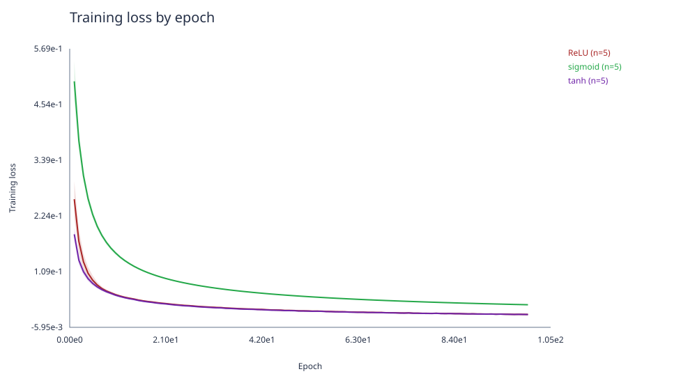

Po 100 epokach tanh i ReLU osiągnęły zbliżoną średnią stratę uczącą, niższą niż sigmoid. W tych warunkach sigmoid słabiej minimalizował CCE. Niższa strata nie musi jednak oznaczać większej dokładności klasyfikacji, ponieważ uwzględnia także prawdopodobieństwa przypisane klasom.

**Klasyfikacja — `three_gauss`.**

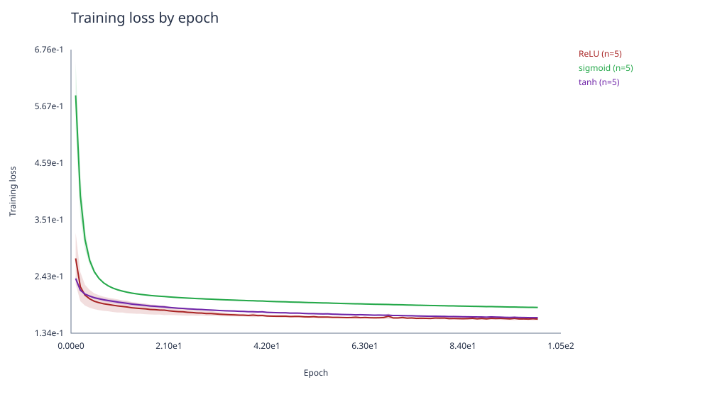

Najniższą średnią stratę końcową uzyskało ReLU, następnie tanh, a najwyższą sigmoid. 

**Regresja — `activation`.**

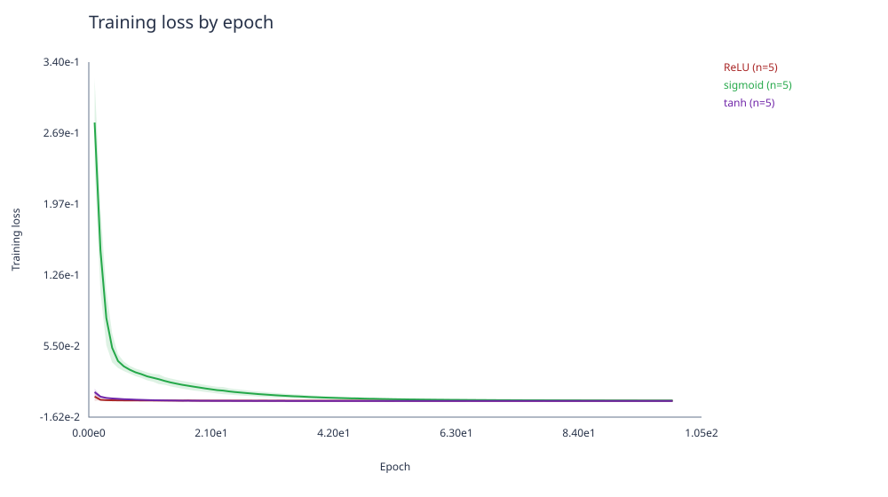

Najniższą średnią stratę końcową osiągnął tanh, następnie ReLU i sigmoid. Końcowe odchylenie standardowe dla ReLU było większe niż jego średnia strata, co wskazuje na dużą zależność wyniku od ziarna w tej konfiguracji.

**Regresja — `cube`.**

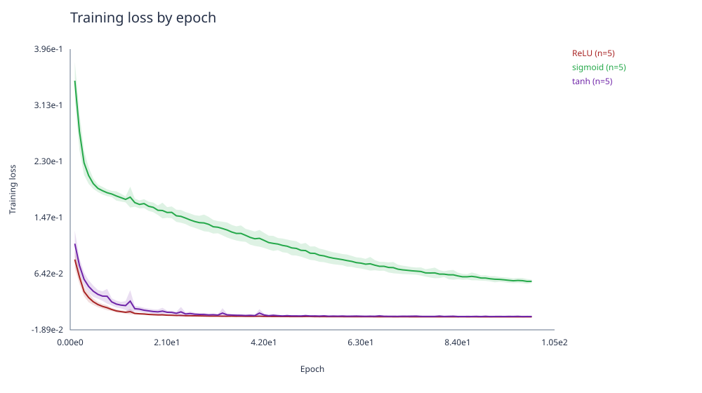

ReLU uzyskało najniższą średnią stratę końcową, a tanh nieco wyższą. Sigmoid zakończył uczenie ze znacznie większą stratą. 

Wyniki nie wskazują jednej najlepszej aktywacji dla wszystkich zbiorów: tanh uzyskał najniższą końcową stratę uczącą dla `simple` i `activation`, a ReLU dla `three_gauss` i `cube`.

### 3.4.2 Końcowa jakość modeli na zbiorach testowych

W klasyfikacji accuracy oznacza odsetek poprawnie rozpoznanych próbek: $\mathrm{accuracy}=\frac{\text{liczba poprawnych odpowiedzi}}{\text{liczba wszystkich próbek}}$.

| Zbiór | Sigmoid | tanh | ReLU |
|---|---|---|---|
| `simple` (1000 próbek testowych) | **99,68% ± 0,11 p.p.** | 99,50% ± 0,19 p.p. | 99,50% ± 0,17 p.p. |
| `three_gauss` (3000 próbek testowych) | 92,76% ± 0,06 p.p. | 93,40% ± 0,08 p.p. | **93,57% ± 0,13 p.p.** |

W regresji wykorzystano testowe MSE w oryginalnych jednostkach celu: $\mathrm{MSE}=\frac1{N_{\mathrm{test}}}\sum_i(\hat y_i-y_i)^2$. Mniejsza wartość oznacza lepszy wynik. Metrykę obliczono po odwróceniu standaryzacji, bez współczynnika $1/2$, dlatego jej wartości różnią się od straty na wykresach uczenia. Jednostka MSE jest kwadratem jednostki celu.

| Zbiór | Sigmoid | tanh | ReLU |
|---|---|---|---|
| `activation` (1201 próbek testowych) | 181,15 ± 53,52 | **39,56 ± 26,88** | 1447,27 ± 616,33 |
| `cube` (1201 próbek testowych) | 70203,25 ± 953,99 | 49309,18 ± 1070,74 | **26605,87 ± 1935,75** |

## 3.5 Eksperyment 2: liczba warstw ukrytych i neuronów

**Cel:** zbadać wpływ głębokości i liczności warstw sieci (od 0 do 4 warstw ukrytych).

| Liczba warstw ukrytych | Architektury (neurony w kolejnych warstwach ukrytych) |
|---|---|
| 0 | [] |
| 1 | [4], [8], [16] |
| 2 | [8,8] |
| 3 | [8,8,8] |
| 4 | [8,8,8,8] |

| Parametr | Wartości |
|---|---|
| Architektura | 7 powyższych |
| Aktywacja ukryta | tanh |
| Wyjście, strata, $\eta$ | bazowe |
| Pliki | 4 pary uczący/testowy: `simple`, `three_gauss`, `activation`, `cube`, wyłącznie wariant $N=1000$ |
| Ziarna | 1–5, po 5 uruchomień na architekturę i zbiór |
| Liczba epok, batch | 100 epok, $B=16$ |

### 3.5.1 Wyniki i wnioski

Wykonano 140 treningów: 4 zbiory $\times$ 7 architektur $\times$ 5 ziaren. Wszystkie zakończyły się poprawnie. 

Linie pokazują średnią stratę na całym zbiorze uczącym po danej epoce z pięciu niezależnych treningów (ziarna 1–5). Cieniowanie oznacza średnią $\pm$ jedno odchylenie standardowe z próby, z dolną granicą przyciętą do zera; nie jest przedziałem ufności. Legendy opisują wyłącznie warstwy ukryte: `[]` oznacza ich brak. 

**Klasyfikacja — `simple`.**

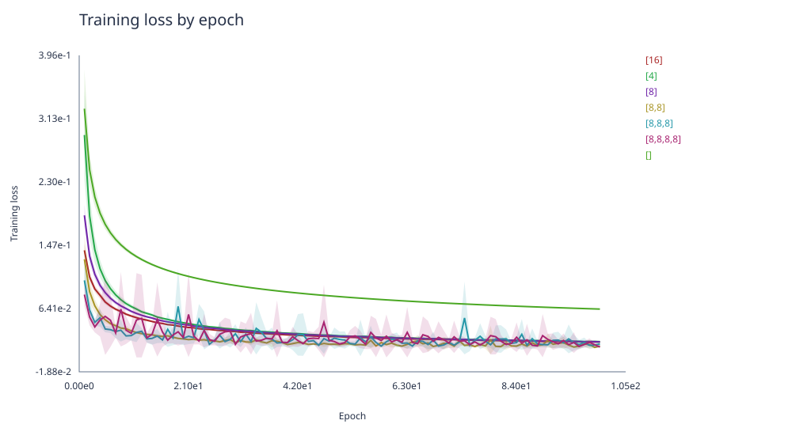

Najniższą średnią stratę osiągnęła architektura [8,8,8,8].

**Klasyfikacja — `three_gauss`.**

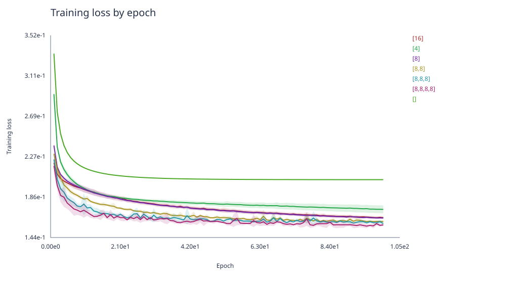

Najniższą średnią stratę końcową uzyskała sieć  [8,8,8,8].  

**Regresja — `activation`.**

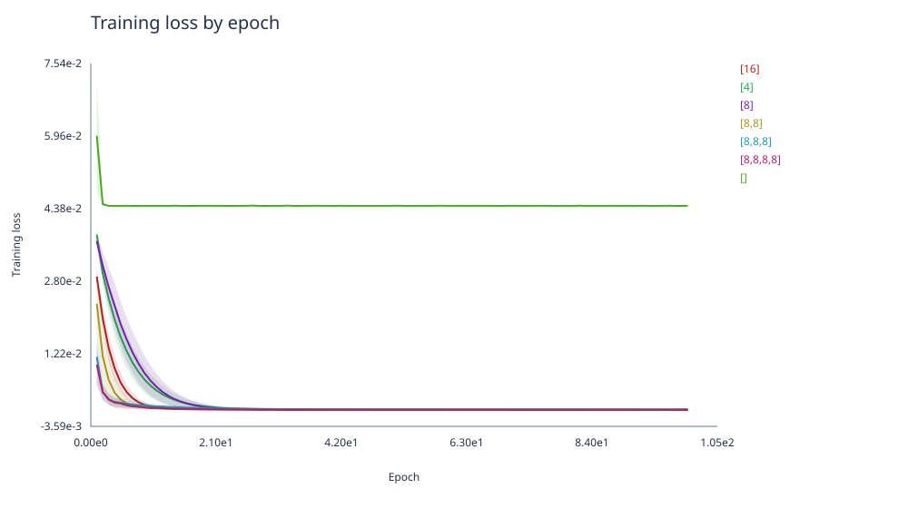

Najniższą średnią stratę uczącą oraz najniższe średnie testowe MSE uzyskała architektura [8,8,8,8]. 

**Regresja — `cube`.**

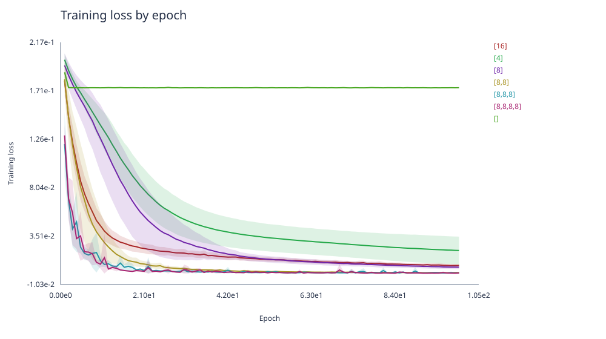

Najniższą średnią stratę uczącą uzyskała architektura [8,8,8,8]. Najniższe średnie testowe MSE uzyskała jednak pojedyncza warstwa [16]. 

### 3.5.2 Końcowa jakość modeli na zbiorach testowych

Po 100 epokach każdy model oceniono na zbiorze testowym. Wyniki podano jako średnią $\pm$ odchylenie standardowe z próby dla pięciu ziaren (1–5). Dla klasyfikacji większa accuracy oznacza lepszy wynik; odchylenie podano w punktach procentowych.

| Warstwy ukryte | Accuracy — `simple` | Accuracy — `three_gauss` |
|---|---|---|
| [] | **99,64% ± 0,09 p.p.** | 92,39% ± 0,01 p.p. |
| [4] | 99,48% ± 0,16 p.p. | 93,19% ± 0,15 p.p. |
| [8] | 99,50% ± 0,19 p.p. | 93,40% ± 0,08 p.p. |
| [16] | 99,38% ± 0,16 p.p. | 93,35% ± 0,12 p.p. |
| [8,8] | 99,34% ± 0,18 p.p. | 93,57% ± 0,12 p.p. |
| [8,8,8] | 99,28% ± 0,13 p.p. | **93,65% ± 0,11 p.p.** |
| [8,8,8,8] | 99,42% ± 0,08 p.p. | 93,53% ± 0,05 p.p. |

W regresji pokazano MSE w oryginalnych jednostkach celu, po odwróceniu standaryzacji i bez współczynnika $1/2$. Mniejsza wartość oznacza lepszy wynik. Nie jest to ta sama wielkość co strata na wykresach uczenia.

| Warstwy ukryte | Testowe MSE — `activation` | Testowe MSE — `cube` |
|---|---|---|
| [] | 2461,02 ± 58,91 | 93348,46 ± 808,24 |
| [4] | 5,99 ± 3,49 | 67504,91 ± 5607,55 |
| [8] | 9,84 ± 11,70 | 57237,88 ± 1711,81 |
| [16] | 63,02 ± 42,05 | **52322,40 ± 926,35** |
| [8,8] | 6,36 ± 4,59 | 54784,86 ± 3018,65 |
| [8,8,8] | 19,92 ± 19,97 | 56643,78 ± 2665,46 |
| [8,8,8,8] | **5,68 ± 4,36** | 62359,32 ± 1249,54 |

Najlepsza średnia jakość testowa zależała od zbioru, a większa liczba warstw lub neuronów nie dawała systematycznej poprawy. 

## 3.6 Eksperyment 3: miara błędu

**Cel:** zbadać wpływ funkcji straty na skuteczność uczenia (dwie miary dla klasyfikacji i dwie dla regresji).

| Zadanie | Wariant | Aktywacja wyjścia | Strata |
|---|---|---|---|
| klasyfikacja | C1 (bazowy) | softmax | CCE |
| klasyfikacja | C2 | softmax | MSE |
| regresja | R1 (bazowy) | liniowa | MSE |
| regresja | R2 | liniowa | MAE |

| Parametr | Wartości |
|---|---|
| Architektura, aktywacja ukryta, $\eta$ | bazowe |
| Pliki | 4 pary uczący/testowy: `simple`, `three_gauss`, `activation`, `cube`, wyłącznie wariant $N=1000$ |
| Ziarna | 1–5, po 5 uruchomień na funkcję straty i zbiór |
| Liczba epok, batch | 100 epok, $B=16$ |

### 3.6.1 Wyniki i wnioski

Wykonano 40 treningów: 4 zbiory $\times$ 2 funkcje straty $\times$ 5 ziaren. Wszystkie zakończyły się poprawnie. 

Na wykresach pokazano średnią stratę na całym zbiorze uczącym po każdej epoce z pięciu niezależnych treningów (ziarna 1–5). Cieniowanie oznacza średnią $\pm$  odchylenie standardowe z próby. 

**Klasyfikacja — `simple`.**

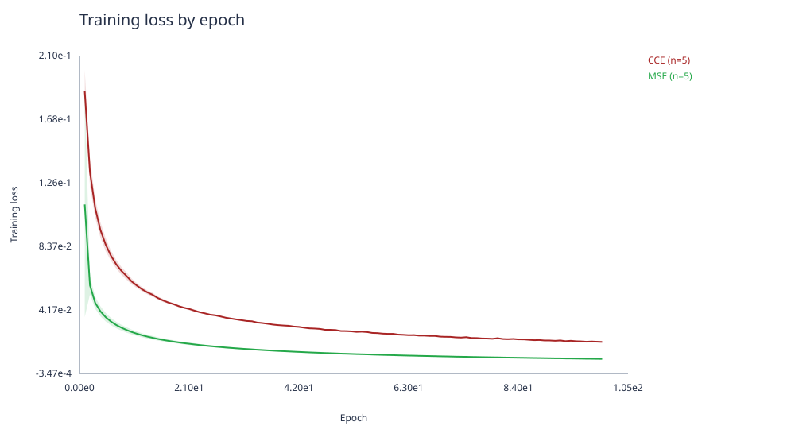

**Klasyfikacja — `three_gauss`.**

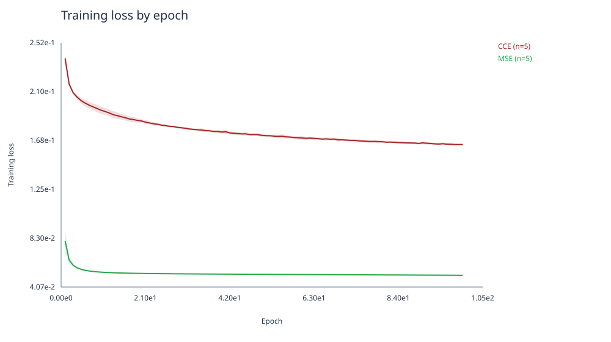

**Regresja — `activation`.**

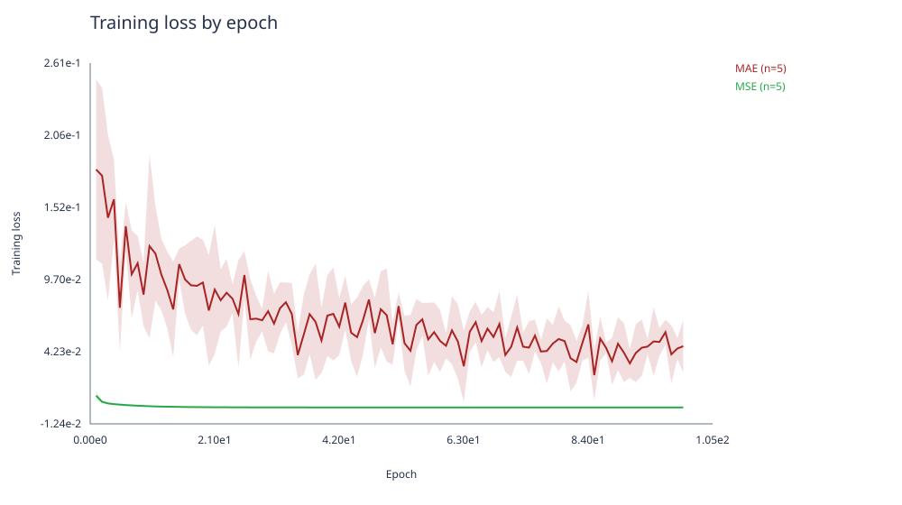

**Regresja — `cube`.**

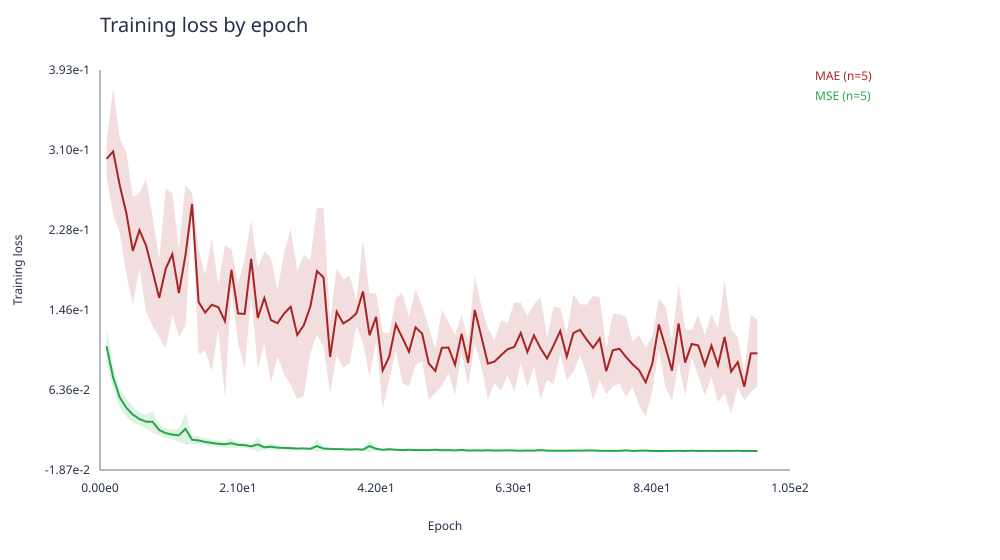

### 3.6.2 Końcowa jakość modeli na zbiorach testowych

Wartości podano jako średnią $\pm$ odchylenie standardowe z próby dla pięciu ziaren (1–5), po 100 epokach. W klasyfikacji większa accuracy oznacza lepszy wynik; odchylenie podano w punktach procentowych.

| Zbiór | Uczenie z CCE — accuracy | Uczenie z MSE — accuracy |
|---|---|---|
| `simple` (1000 próbek testowych) | 99,50% ± 0,19 p.p. | **99,64% ± 0,15 p.p.** |
| `three_gauss` (3000 próbek testowych) | **93,40% ± 0,08 p.p.** | 92,96% ± 0,08 p.p. |

W regresji oba warianty oceniono tym samym testowym MSE: średnią kwadratów błędów po odwróceniu standaryzacji celu, bez współczynnika $1/2$. Mniejsza wartość oznacza lepszy wynik. Nazwy kolumn określają funkcję straty stosowaną podczas uczenia, a nie sposób obliczania metryki w tabeli.

| Zbiór | Uczenie z MSE — testowe MSE | Uczenie z MAE — testowe MSE |
|---|---|---|
| `activation` (1201 próbek testowych) | **39,56 ± 26,88** | 40,55 ± 24,87 |
| `cube` (1201 próbek testowych) | **49309,18 ± 1070,74** | 67535,70 ± 1729,90 |

W regresji uczenie z MSE dało niższe średnie testowe MSE na obu zbiorach, ale dla `activation` różnica była niewielka względem rozrzutu wyników. 

# 4. Rozpoznawanie cyfr MNIST — podejście i wyniki eksperymentów

## 4.1 Cel i przygotowanie danych

Celem tej części było sprawdzenie, czy ta sama implementacja MLP potrafi rozpoznawać cyfry pisane odręcznie. Wykorzystano istniejącą sieć, bez dodawania nowych mechanizmów uczenia. Zmieniono jedynie dane i parametry modelu. Przeprowadzono dwa porównania: szerokości warstwy ukrytej oraz jej aktywacji.

Każdy obraz MNIST ma rozmiar 28 × 28 pikseli i etykietę od 0 do 9. Obraz jest spłaszczany wierszami do wektora 784 liczb, bez zmiany kolejności pikseli. Sieć otrzymuje więc 784 wejścia, a jej warstwa wyjściowa ma 10 neuronów — po jednym na cyfrę. 

Dane przygotowuje istniejący skrypt `scripts/prepare_mnist.py`. Wczytuje on obrazy i etykiety z lokalnych plików, dzieli wartości pikseli przez 255 i zapisuje pliki `train.csv`, `test.csv` oraz `metadata.json`. W każdym wierszu CSV znajduje się 784 wartości pikseli i etykieta w ostatniej kolumnie. Według obecnego `data/mnist/metadata.json` wyeksportowano pełne zbiory: 60000 próbek uczących i 10000 testowych.

## 4.2 Sposób uczenia i oceny

Uczenie prowadzono wyłącznie na oficjalnym zbiorze uczącym. Zbiór testowy posłużył do oceny gotowych modeli po zakończeniu treningu: nie był używany do obliczania gradientów ani wyboru epoki zakończenia. 

Przedstawione wyniki obejmują pełny zbiór 60000 próbek uczących oraz te same 10000 próbek testowych dla wszystkich wariantów. Nie są wynikami uczenia na podzbiorze 5000 próbek.

W przeprowadzonych eksperymentach zastosowano następującą konfigurację bazową:

| Parametr | Wartość |
|---|---|
| Wejścia / wyjścia | 784 / 10 |
| Warstwy ukryte | [64] |
| Aktywacja ukryta | tanh |
| Aktywacja wyjściowa | softmax |
| Funkcja straty | CCE |
| Algorytm | mini-batch SGD, tasowanie przed każdą epoką |
| Współczynnik uczenia | 0,01 |
| Batch | 64 |
| Liczba epok | 10 |
| Bias | włączony |
| Ziarna treningu | 1, 2, 3 |

Podstawową miarą końcowej jakości była accuracy na zbiorze testowym. Dodatkowo podano liczby poprawnych i błędnych odpowiedzi, końcową CCE oraz czas treningu. Dla trzech ziaren wyniki przedstawiono jako średnią i odchylenie standardowe z próby. Liczby poprawnych odpowiedzi wyznaczono z accuracy i liczności zbioru testowego; błędne odpowiedzi stanowią pozostałą część z 10000 próbek.

## 4.3 Eksperyment MNIST 1: liczba neuronów w warstwie ukrytej

**Cel:** porównać jakość i koszt uczenia sieci z jedną warstwą ukrytą o różnej szerokości.

| Parametr | Wartości |
|---|---|
| Warstwy ukryte | [64], [128] |
| Aktywacja ukryta | tanh |
| Pozostałe ustawienia | konfiguracja bazowa z punktu 4.2 |
| Dane | pełna para MNIST: 60000 uczących / 10000 testowych |
| Ziarna | 1, 2, 3 |
| Liczba treningów | 6 |

## 4.4 Eksperyment MNIST 2: funkcja aktywacji

**Cel:** sprawdzić wpływ aktywacji warstwy ukrytej przy niezmienionej architekturze.

| Parametr | Wartości |
|---|---|
| Warstwy ukryte | [64] |
| Aktywacja ukryta | tanh, ReLU |
| Pozostałe ustawienia | konfiguracja bazowa z punktu 4.2 |
| Dane | pełna para MNIST: 60000 uczących / 10000 testowych |
| Ziarna | 1, 2, 3 |
| Liczba treningów | 6, w tym 3 wspólne z eksperymentem MNIST 1 |

## 4.5 Przebieg uczenia

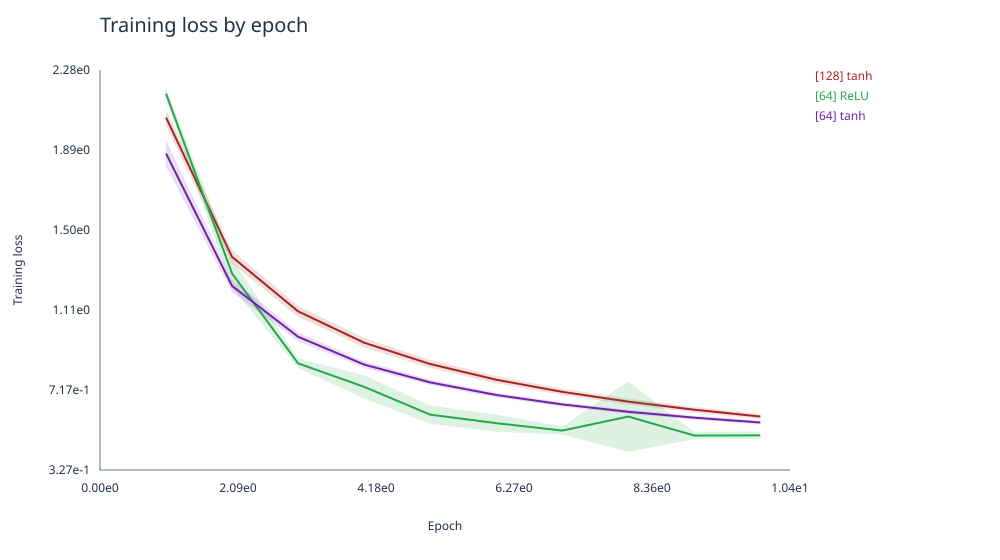

Każda linia przedstawia średnią CCE na całym zbiorze uczącym po danej epoce, obliczoną z trzech treningów (ziarna 1–3). Cieniowanie oznacza średnią $\pm$  odchylenie standardowe z próby. 

Między pierwszą a dziesiątą epoką średnia strata ucząca spadła dla wszystkich trzech konfiguracji. ReLU [64] zakończyło trening z najniższą średnią CCE. Wyniki dotyczą ustalonych 10 epok — nie sprawdzono, jak zmieniłyby się po dłuższym uczeniu.

## 4.6 Końcowa jakość modeli

Poniższe wartości to średnie $\pm$ odchylenia standardowe z próby dla trzech ziaren. Accuracy podano w procentach, a jej odchylenie w punktach procentowych. 

| Warstwy ukryte | Aktywacja | Testowa accuracy | CCE ucząca | CCE testowa | Czas treningu [s] |
|---|---|---|---|---|---|
| [64] | tanh | 82,59% ± 0,21 p.p. | 0,55852 ± 0,00926 | 0,58358 ± 0,00754 | 51,33 ± 1,97 |
| [128] | tanh | 83,96% ± 0,06 p.p. | 0,58765 ± 0,01254 | 0,69085 ± 0,01978 | 97,87 ± 0,71 |
| [64] | ReLU | **86,80% ± 0,05 p.p.** | **0,49600 ± 0,01828** | **0,53113 ± 0,00893** | 49,66 ± 0,19 |

Liczby poprawnych i błędnych odpowiedzi dla każdego modelu na 10000 próbek testowych:

| Warstwy ukryte | Aktywacja | Ziarno | Poprawne odpowiedzi | Błędne odpowiedzi | Accuracy |
|---|---|---|---|---|---|
| [64] | tanh | 1 | 8254 | 1746 | 82,54% |
| [64] | tanh | 2 | 8242 | 1758 | 82,42% |
| [64] | tanh | 3 | 8282 | 1718 | 82,82% |
| [128] | tanh | 1 | 8402 | 1598 | 84,02% |
| [128] | tanh | 2 | 8391 | 1609 | 83,91% |
| [128] | tanh | 3 | 8394 | 1606 | 83,94% |
| [64] | ReLU | 1 | 8678 | 1322 | 86,78% |
| [64] | ReLU | 2 | 8677 | 1323 | 86,77% |
| [64] | ReLU | 3 | **8686** | **1314** | **86,86%** |

Najwyższą średnią accuracy i najniższą średnią testową CCE spośród badanych konfiguracji uzyskała sieć [64] z ReLU. 

Eksperyment potwierdził, że istniejąca implementacja może uczyć się rozpoznawania cyfr MNIST po zmianie danych i parametrów. 

# 5. Wnioski końcowe

Zaimplementowany od podstaw perceptron wielowarstwowy umożliwił rozwiązywanie zadań klasyfikacji i regresji oraz rozpoznawanie cyfr MNIST. Tę samą implementację wykorzystano we wszystkich częściach projektu, zmieniając dane, architekturę i parametry uczenia. Propagacja wsteczna i mini-batch SGD pozwoliły zmniejszać stratę uczącą, a zapisywane historie umożliwiły porównanie przebiegu treningów. 

Nie uzyskano jednej funkcji aktywacji najlepszej dla wszystkich zadań.  Wybór aktywacji powinien więc uwzględniać dane i pozostałe ustawienia modelu, a nie wyłącznie wynik pojedynczego treningu.

Zwiększanie liczby neuronów i głębokości sieci nie zapewniało systematycznej poprawy jakości testowej. W eksperymencie architektur dla `simple` najwyższą średnią accuracy uzyskała sieć bez warstw ukrytych, dla `three_gauss` architektura [8,8,8], dla regresji `activation` najniższe średnie testowe MSE osiągnęła [8,8,8,8], a dla `cube` [16]. 

Porównanie funkcji straty pokazało potrzebę stosowania wspólnej metryki oceny. Wartości CCE, MSE i MAE mają różne znaczenie i skalę, dlatego nie można porównywać modeli wyłącznie na podstawie wysokości ich krzywych. W klasyfikacji uczenie z MSE dało nieco wyższą średnią accuracy dla `simple`, a CCE dla `three_gauss`. 

W MNIST najlepszą z trzech badanych konfiguracji była jedna warstwa ukryta z 64 neuronami i ReLU: średnia testowa accuracy wyniosła **86,80% ± 0,05 p.p.**. Podwojenie szerokości warstwy z tanh poprawiło accuracy, ale niemal podwoiło czas treningu i nie obniżyło CCE. 
